# NomadWay — Smart Travel, Live Weather & Interactive Trip Planner

**Course:** Web Technologies 1 (Front End) — Final Project  
**University:** Astana IT University  
**Student:** Askar Nurmukhammed (`IT-2514`)  
**Instructor:** Daniyar Amantayev  

---

## 1. Project Overview

**NomadWay** is a 5-page responsive, interactive web application for discovering curated travel destinations across Kazakhstan, inspecting real-time weather telemetry via a public REST API, planning a custom 3-day itinerary with Drag & Drop, testing expedition readiness, and submitting validated tour bookings.

### Core Architecture
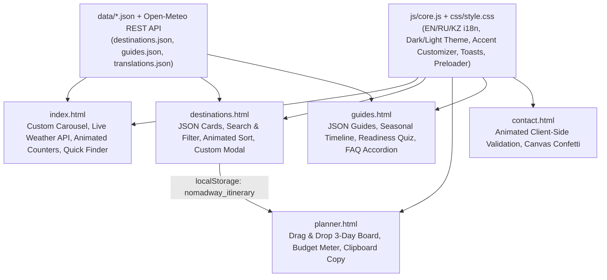

---

## 2. Project Structure

```text
final_project/
├── index.html                   # Home: Custom Carousel, Live Weather API, Counters, Quick Finder
├── destinations.html            # Catalog: Search, Filter, Animated Sort, Custom JS/jQuery Modal
├── planner.html                 # 3-Day Drag & Drop Trip Board, Budget Tracker, Clipboard Export
├── guides.html                  # Local Guides, Seasonal Timeline, 5-Q Quiz, FAQ Accordion
├── contact.html                 # Validated Booking Form + HTML5 Canvas Confetti Celebration
├── css/
│   └── style.css                # CSS Variables (Light/Dark + 3 Accents), Animations, Responsive Rules
├── js/
│   ├── core.js                  # Shared i18n (EN/RU/KZ), Theme/Accent, Toasts, Preloader, Scroll Spy
│   ├── home.js                  # Custom Carousel state machine, Open-Meteo API, Counters, Finder
│   ├── destinations.js          # JSON renderer, Search/Filter/Sort, Custom Modal, Planner sync
│   ├── planner.js               # jQuery UI Sortable Drag & Drop, Budget bar, Clipboard API
│   ├── guides.js                # JSON Guides & Interactive 5-Question Quiz
│   └── contact.js               # RegExp/Date validation + Canvas Confetti burst
├── data/
│   ├── destinations.json        # 8 localized destinations with coordinates, ratings, prices
│   ├── guides.json              # Localized guides & 5 quiz questions
│   ├── translations.json        # Full UI dictionary (EN / RU / KZ)
│   └── fallback-data.js         # CORS-safe fallback when opened directly via file://
├── assets/images/               # Optimized local imagery (lazy-loaded)
├── screenshots/                 # Verified Desktop, Tablet, Mobile & Interactive captures
├── report/capture_screenshots.py# Playwright Chromium E2E & screenshot verification script
├── build_zip.py                 # Submission packager
└── README.md                    # Project Documentation & Visual Report
```

---

## 3. Evaluation Criteria Coverage (`Final Project Criteria.pdf`)

### A. Technical Implementation (60%)
| Criterion | Weight | Implemented Solution |
| :--- | :---: | :--- |
| **Project Structure & Pages** | 5% | 5 interconnected pages (`index.html`, `destinations.html`, `planner.html`, `guides.html`, `contact.html`) with unified navbar, active `aria-current="page"` indicator, live planner badge, and 4-column footer. |
| **Design Consistency & Usability** | 5% | Unified visual tokens (`--accent-primary`, `--bg-surface`, `--text-main`), consistent typography, rounded card hierarchy, and intuitive action controls. |
| **Responsiveness & Accessibility** | 10% | Bootstrap 5.3 12-column responsive grid + custom media queries verified at `1440px`, `768px`, and `375px` with zero horizontal overflow; semantic HTML5 landmarks (`<nav>`, `<header>`, `<main>`, `<footer>`), `alt` texts, `aria-label`, `aria-live`, and keyboard Escape/focus handling. |
| **Bootstrap & Custom Styling** | 15% | Bootstrap 5.3 layout/grid/forms/accordion combined with custom glassmorphism navbar, custom carousel & modal styling, Drag & Drop board dropzones, CSS dark-mode overrides, and keyframe animations. |
| **JavaScript & jQuery Logic** | 20% | Modular ES6 + jQuery 3.7 + jQuery UI architecture across 6 dedicated JS modules (`core.js`, `home.js`, `destinations.js`, `planner.js`, `guides.js`, `contact.js`). |
| **Code Quality & Optimization** | 5% | Strict separation of structure (HTML), presentation (CSS), data (JSON), and behavior (JS); `loading="lazy"` on destination images; zero console/HTTP errors. |

### C. Bonus Features Implemented (Cap: +10%)
1. **JSON / Public API Integration (+5%):** Dynamic loading of `data/destinations.json`, `data/guides.json`, and `data/translations.json` via `fetch()` (with transparent `file://` fallback), plus live **Open-Meteo Weather REST API** telemetry for Astana, Almaty, and Aktau.
2. **Multi-Language Localization EN / RU / KZ (+5%):** Full site-wide dynamic translation loaded from `translations.json` and persisted in `localStorage` (`nomadway_lang`), re-rendering both static DOM elements and JSON-generated cards/modals/quizzes.
3. **Drag & Drop Interaction (+4%):** 3-day Trip Planner built with **jQuery UI `.sortable({ connectWith: ".planner-dropzone" })`** allowing cards to be dragged across Available Stops and Day 1–3 columns (with quick-move buttons for mobile/keyboard accessibility) and persisted in `localStorage`.
4. **Custom Carousel & Custom Modal without Bootstrap JS (+4%):** Both the hero image slider (`nwHeroCarousel`) and destination detail dialog (`nwCustomModalBackdrop`) are engineered from scratch using JS/jQuery state logic, transitions, dot indicators, hover pause, and Escape/backdrop close.
5. **Dark / Light Mode (+3%) & Live Accent Customizer (+3%):** Global CSS custom property themes (`data-theme="dark"` and Indigo/Emerald/Amber accents) saved in `localStorage`.
6. **Search / Filter (+3%) & Dynamic Animated Sorting (+3%):** Real-time keyword search, terrain category filtering, and price/rating/duration sorting with jQuery fade transitions.
7. **Additional Interactive Enhancements:** Toast Notification System (+3%), Animated Scroll Counters & Progress Bar (+3%), Enhanced Form Validation with animated shake (+3%), HTML5 `<canvas>` Confetti Celebration (+2%), Clipboard Copy API (+2%), Custom Preloader (+2%), Smooth Back-to-Top Button (+2%), Travel Readiness Quiz (+2%), and Scroll Reveal Animations (+3%).

---

## 4. Visual Report & Verified Screenshots

### Home Page — Custom Carousel & Live Open-Meteo Weather API (`1440×900`)
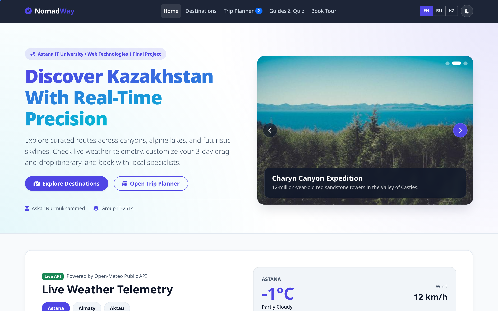

### Dark Mode + Kazakh (`KZ`) Localization & Quick Route Finder
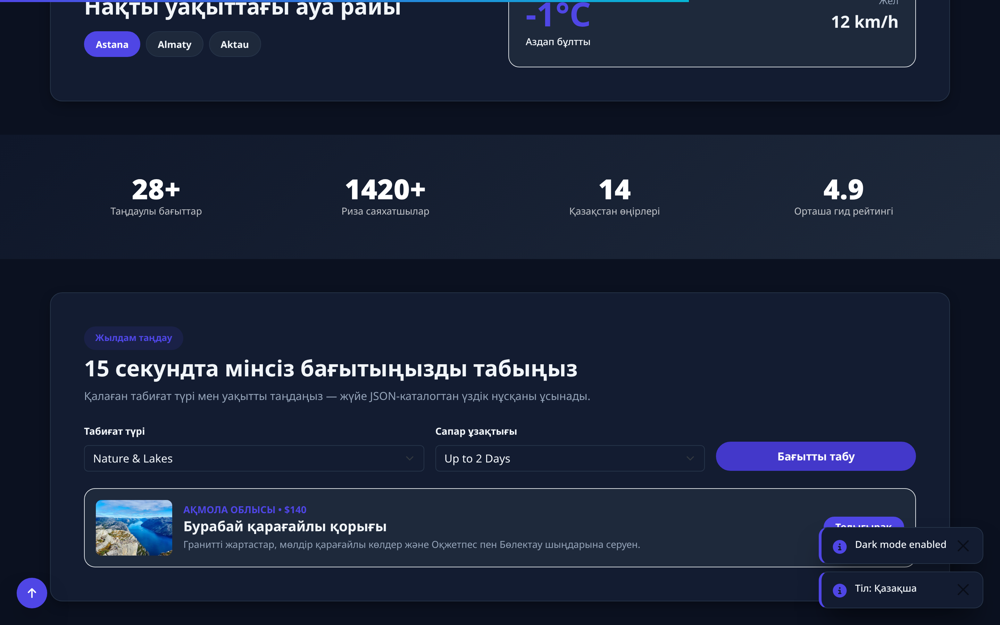

### Destinations Catalog — Dynamic JSON Cards, Filter, Search & Animated Sort
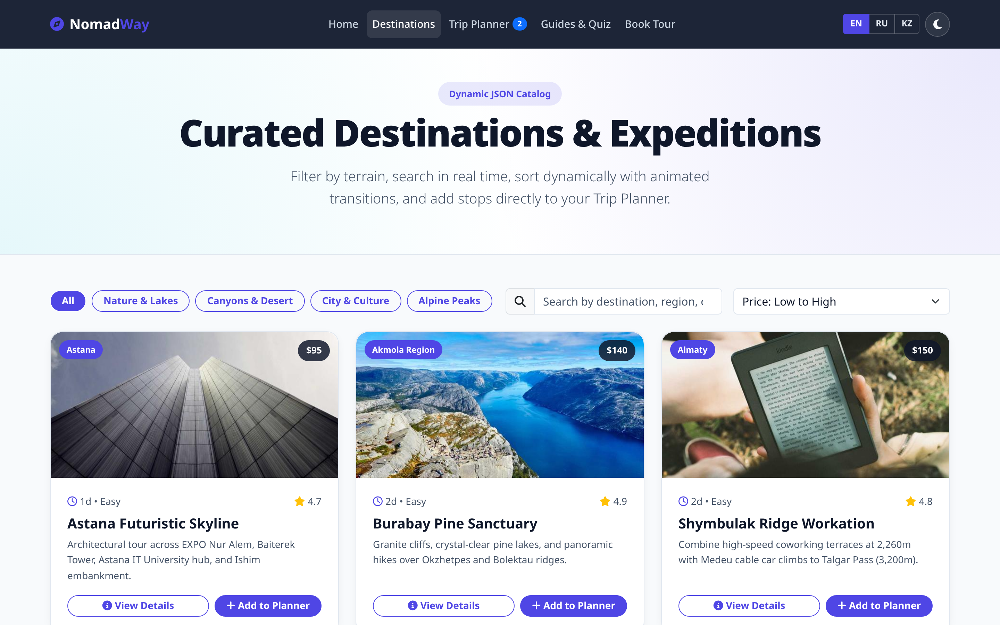

### Custom JS/jQuery Detail Modal (Built Without Bootstrap Modal Plugin)
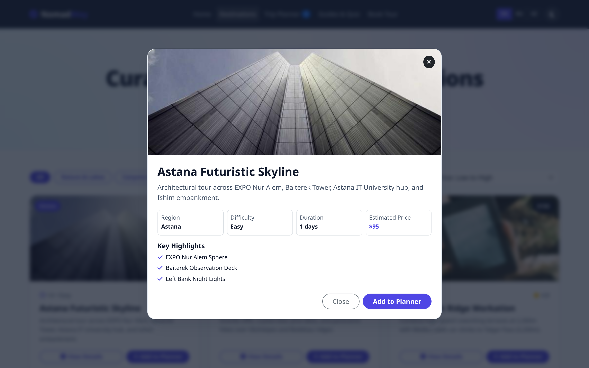

### Interactive 3-Day Drag & Drop Trip Planner, Budget Meter & Clipboard Copy
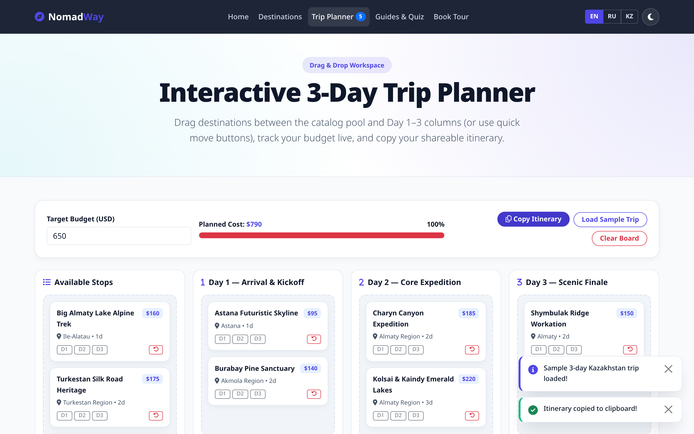

### Guides & Travel Readiness Quiz in Russian (`RU`) — Evaluated `5 / 5 (100%)`
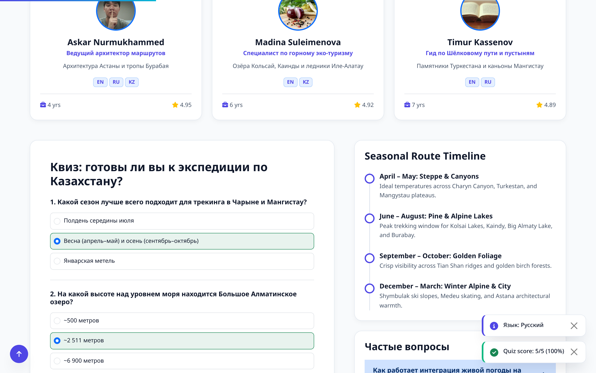

### Client-Side Form Validation — Real-Time Error Feedback & Toast
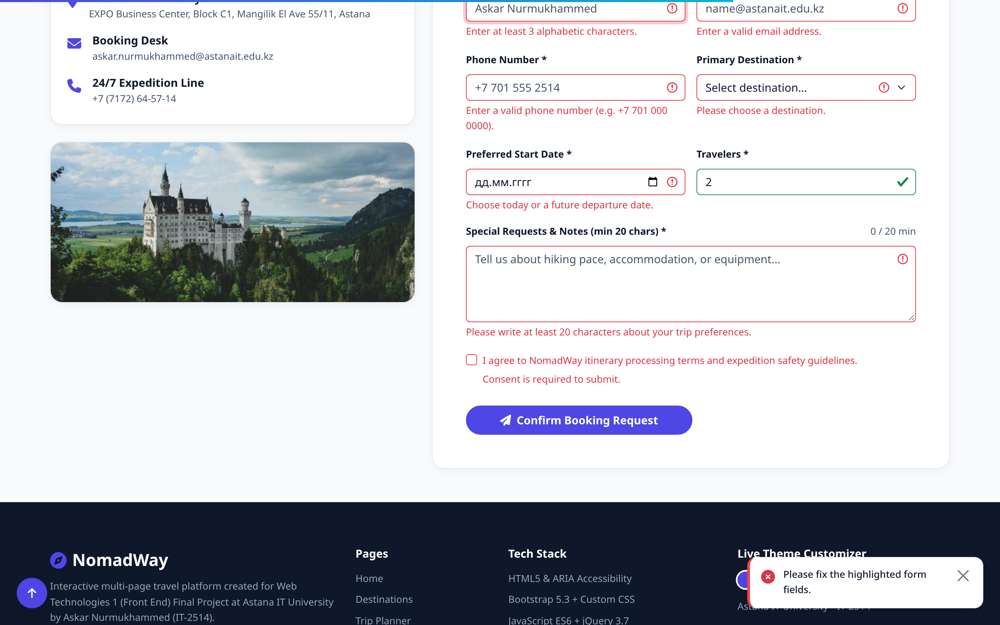

### Valid Booking Submission — Reference ID & Canvas Confetti Celebration
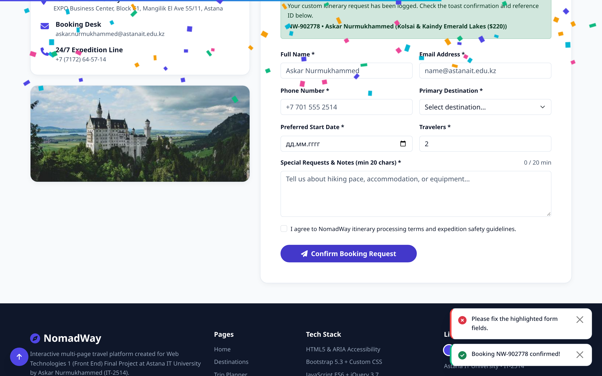

### Responsive Verification — Tablet (`768×1024`) & Mobile (`375×812`)
| Tablet (`768px`) | Mobile (`375px`) |
| :---: | :---: |
| 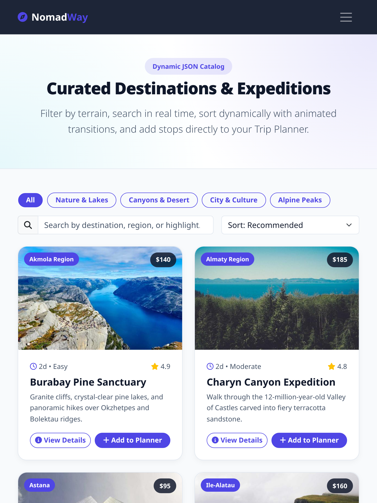 | 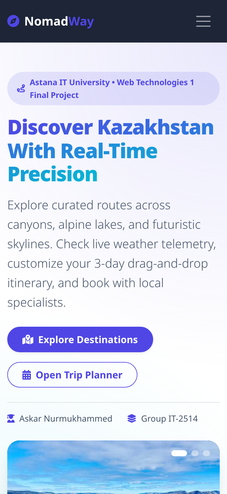 |

---

## 5. How to Run & Verify

### Option 1: Local HTTP Server (Recommended for Live `fetch()` of JSON)
```bash
cd final_project
python3 -m http.server 8080
# Open http://localhost:8080/index.html
```

### Option 2: Direct Browser Open (`file://`)
Simply open `index.html` in Chrome, Edge, Firefox, or Safari. `data/fallback-data.js` automatically provides the structured JSON datasets if browser CORS restricts `file://` fetch requests.

### Automated Verification
End-to-end Playwright Chromium verification (`report/capture_screenshots.py`) confirms:
- **0** console errors, **0** uncaught page exceptions, and **0** HTTP `>=400` responses across all 5 pages.
- **0** horizontal overflow on Desktop (`1440px`), Tablet (`768px`), and Mobile (`375px`).
- Full interactive verification for i18n persistence (`EN/RU/KZ`), Dark/Light toggle, JSON filtering/sorting, custom modal, Drag & Drop board + budget math, 5/5 quiz scoring, and form validation/confetti.
